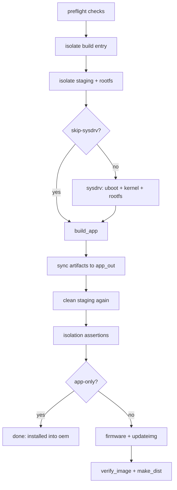

<div align="center">

</div>

<h1 align="center">QZdesk SDK</h1>

<p align="center">A complete Luckfox <b>RV1106</b> SDK: cross toolchain, kernel, rootfs, media libraries and the <code>oem</code> tree, with one command that produces a <b>QZdesk</b> desktop or <b>QZcam</b> camera image</p>

<p align="center">
🇨🇳 <a href="./README.md">简体中文</a> | 🇺🇸 <a href="./README.en.md">English</a>
</p>

---

> [!NOTE]
> This is the **QZdesk SDK** — the common base for [QZdesk](https://github.com/QZzwj/QZdesk) (a desktop AI terminal) and [QZcam](https://github.com/QZzwj/QZcam) (camera firmware). Both are separate repositories, wired into `project/app/` here through symlinks; the SDK owns the board configs, kernel/rootfs, media libraries and the `oem` tree they install into.

## Table of Contents

- [Introduction](#introduction)
- [Board and Partitions](#board-and-partitions)
- [How the Repos Fit Together](#how-the-repos-fit-together)
- [Getting Started](#getting-started)
- [One Command, One Image: tools/build](#one-command-one-image-toolsbuild)
- [Deploy to a Live Board](#deploy-to-a-live-board)
- [Flashing](#flashing)
- [Layout](#layout)
- [License](#license)

## Introduction

The QZdesk SDK is a productized trim of the Luckfox Pico **RV1106** SDK: the kernel, u-boot, buildroot rootfs and Rockchip media libraries stay stock, and the customization lives in `project/app/` and the board configs, so a single SDK can serve two firmware products with completely different screens.

Exactly one interface is exposed to the outside — [`tools/build/build_image.sh`](./tools/build/build_image.sh):

| What you want | The one command | Artifact |
| --- | --- | --- |
| Camera end (full-screen viewfinder, single app) | `tools/build/build_image.sh --cam` | `output/image/update-cam.img` |
| Desktop end (local AI desktop terminal) | `tools/build/build_image.sh --desk` | `output/image/update-desk.img` |

> [!IMPORTANT]
> An image can contain **exactly one UI application**. With both QZdesk and QZcam present they fight over the same framebuffer and the screen flips back and forth. `build_image.sh` enforces this in five layers of hard isolation (see "Hard Isolation" below) and stops without producing an image if any layer fails.

## Board and Partitions

| Item | Value |
| --- | --- |
| SoC | RV1106 (`RK_CHIP=rv1106`, ARMv7 Cortex-A7 + NPU), 66 MB CMA |
| Kernel | Linux **5.10.160** (`qzdesk_rv1106_linux_defconfig`) |
| u-boot | `qzdesk_rv1106_uboot_defconfig` |
| rootfs | Buildroot (`qzdesk_defconfig`, uclibc) |
| Boot medium | SPI NAND (shipping), plus an SD-card variant |
| Kernel DTS | `rv1106g-qzdesk.dts` |
| WiFi | RTL8723BS (`RK_ENABLE_WIFI=y`) |
| Sensors | SC4336 + SC3336, IQ files ship inside the image's `oem` partition |
| App install | `RK_BUILD_APP_TO_OEM_PARTITION=y` — apps land in the `oem` partition |

Board configs live in [`project/cfg/BoardConfig_IPC/`](./project/cfg/BoardConfig_IPC/):

- `BoardConfig-SPI_NAND-Buildroot-RV1106_QZdesk-DeskMate.mk` — shipping SPI NAND;
- `BoardConfig-SD_CARD-Buildroot-RV1106_QZdesk-DeskMate.mk` — SD-card variant (larger partitions, `ext4`).

SPI NAND partition table (`RK_PARTITION_CMD_IN_ENV`) and filesystems:

```text
env 256K | idblock 256K | uboot 512K | boot 4M | oem 45M | userdata 10M | rootfs 195M
rootfs@ubifs  oem@/oem@ubifs  userdata@/userdata@ubifs
```

## How the Repos Fit Together

There are three repositories in one set: the apps own their own code, the SDK owns the base, and the build wires them together with symlinks.

| Repo | Role |
| --- | --- |
| **QZdesk-SDK** (this repo) | Toolchain, kernel/rootfs/u-boot, media libraries, board configs, `oem` tree, build scripts |
| [QZdesk](https://github.com/QZzwj/QZdesk) | Desktop app: LVGL UI + Rust voice core |
| [QZcam](https://github.com/QZzwj/QZcam) | Camera app: viewfinder, photo, video, gallery |

The wiring on the SDK side (symlinks into each repo's working tree):

```text
project/app/qzdesk/src  ->  <QZdesk>/           # desktop UI + core sources
project/app/qzcam/src   ->  <QZcam>/            # camera sources
tools/                  ->  git submodule (Luckfox cross toolchain + flashing tools)
```

> [!NOTE]
> Cloning only the SDK without those two repos still builds the SDK's own apps (`rkipc`, `uvc_app_tiny`, `wifi_app`, `rk_smart_door`, …). What is missing is just the two UI applications, QZdesk and QZcam.

## Getting Started

```bash
git clone --recursive https://github.com/QZzwj/QZSDK.git
cd QZSDK
git submodule update --init          # pulls tools/: cross toolchain + flashing tools
```

`.BoardConfig.mk` is not tracked, so pick the board once after cloning (this points at the shipping SPI NAND config):

```bash
ln -s project/cfg/BoardConfig_IPC/BoardConfig-SPI_NAND-Buildroot-RV1106_QZdesk-DeskMate.mk .BoardConfig.mk
# or pick interactively:  ./build.sh lunch
```

Host dependencies (Ubuntu 22.04):

```bash
sudo apt-get install -y git ssh make gcc gcc-multilib g++-multilib module-assistant \
  expect g++ gawk texinfo libssl-dev bison flex fakeroot cmake unzip gperf autoconf \
  device-tree-compiler libncurses5-dev pkg-config bc python-is-python3 passwd openssl \
  openssh-server openssh-client vim file cpio rsync
```

> [!WARNING]
> Packing images (`mkfs.ubifs` / `mkimage`) needs **sudo**. `build_image.sh` checks this up front; run `sudo -v` (or configure passwordless sudo) before building, otherwise the failure only shows up at the very last step.

## One Command, One Image: tools/build

[`tools/build/build_image.sh`](./tools/build/build_image.sh) is the **single entry point for release images**: clean environment, board checks, isolation, cross-compilation, install into `oem`, packaging, verification and a labelled release copy — all in one command.

### Overview

| Capability | Description |
| --- | --- |
| One entry, two product lines | `--cam` for the camera end, `--desk` for the desktop end; each target decides which app to build, which init script to keep and which dependencies to install |
| Clean build environment | Runs `./build.sh` through `env -i` with only the necessary variables — no Windows/WSL-injected variable is referenced |
| Five-layer hard isolation | Guarantees exactly one UI app per image; stops on the first violated layer |
| Post-pack assertions | Init-script count, name-based residual scan, pruned-dependency confirmation, artifact freshness, release-copy md5 |
| Labelled release copy | Besides `update.img`, emits `update-<target>.img` + `.txt` (build time, md5, board, included/dropped list) |
| Safe dry run | `--dry-run` prints the plan and checks without touching any file |

### Usage

```bash
# First time: full rebuild (u-boot + kernel + rootfs + media + app), then pack
tools/build/build_image.sh --cam

# Day to day, fastest: skip uboot/kernel/rootfs, rebuild only the app, then pack (1-2 min)
tools/build/build_image.sh --cam --skip-sysdrv

# Compile and install into the oem tree only, no image
tools/build/build_image.sh --cam --app-only

# Desktop image (cross-compiles the Rust voice core first)
tools/build/build_image.sh --desk

# Print the plan and checks without touching anything
tools/build/build_image.sh --cam --dry-run

# Set the parallelism
tools/build/build_image.sh --cam -j 8
```

| Flag | Effect |
| --- | --- |
| `--cam` / `--desk` | Select the product line (default `cam`); aliases `--cameras` / `--desktop` |
| `--only <cam\|desk>` | Legacy spelling, equivalent to `--cam` / `--desk` |
| `--skip-sysdrv` | Skip uboot/kernel/rootfs and rebuild only the app on top of existing artifacts |
| `--app-only` | Compile and install into `oem` only, no packaging (implies `--skip-sysdrv`) |
| `--dry-run` | Rehearsal: print the plan and checks, compile nothing, change nothing |
| `--keep-wifi` | Keep WiFi dependencies on the camera target (dropped by default: `lib/wifi lib/firmware`) |
| `--keep-rkipc` | Keep `rkipc` on the camera target (dropped by default, it fights QZcam for `/dev/video*`) |
| `--camera-demo` / `--demo` | Camera demo image: additionally builds `rkipc` (RTSP) and UVC, temporarily adding `UVC_TINY` to `RK_APP_TYPE` (restored on exit) |
| `--sdk-target <target>` | Pass straight through to the SDK's `./build.sh` (`lunch` / `kernel` / `rootfs` / `media` / `app` / `firmware` / `clean` …), then exit |
| `--sdk <dir>` | SDK root (defaults to two levels up from the script) |
| `-j` / `--jobs <N>` | Parallel build jobs (default `nproc`) |
| `--log <file>` | Log file (default `/tmp/qzdesk-image.log`) |
| `-h` / `--help` | Print the script's header comment (the usage is the documentation) |

| Environment variable | Effect |
| --- | --- |
| `QZCAM_SDK` | SDK root (defaults to two levels up from the script) |
| `QZCAM_LOG` | Log file path (default `/tmp/qzdesk-image.log`) |
| `QZCAM_REBUILD_CORE=1` | Force a rebuild of the desktop Rust core (otherwise a present artifact is reused) |
| `QZCAM_ALLOW_STALE_CORE=1` | Keep the old core artifact if cross-compilation fails (default is to fail hard) |

> [!NOTE]
> The build log goes to a file, so `tail -f /tmp/qzdesk-image.log` works at any time. On failure the script replays the `error/fatal/failed` lines plus the log tail, so you do not have to dig through hundreds of lines yourself.

### Target Profiles: `--cam` vs `--desk`

Every "which one" difference is centralized in the script's `setup_profile()`, so both product lines fit in one table:

| Item | `--cam` (camera) | `--desk` (desktop) |
| --- | --- | --- |
| UI binary | `qzcam` | `qzdesk_screen` |
| Init script | `S30qzcam` | `S30qzdesk` |
| Extra build | — | Cross-compiles the Rust core (`xiaozhi-linux-rs`, armv7-musl) |
| Dropped binaries | `qzdesk_screen`, `xiaozhi_linux_rs`, MCP scripts (`pomodoro.py`, `robot_move.sh`, `set_timer.py`, `system_status.sh`) | `qzcam`, `rkipc` |
| Dropped init scripts | `S30qzdesk`, `S99qzdesk` | `S30qzcam`, `S99qzcam`, `S99qzdesk` |
| Dropped dependency dirs | `lib/wifi`, `lib/firmware` (keep with `--keep-wifi`); `rkipc`, `rk_mpi_uvc` (keep with `--keep-rkipc`) | `usr/share/qzcam`, `lib/camera` |
| Key deps kept | 6 camera driver modules, `iqfiles`, `replace_desktop.sh`, `camera_doctor.sh`, `camera_paths_test.sh` | WiFi modules and firmware, CJK fonts, Rust core |
| Artifact | `output/image/update-cam.img` | `output/image/update-desk.img` |

> [!CAUTION]
> The stock entry `./build.sh app` **silently skips** the build when `LF_WIFI_PSK` / `LF_WIFI_SSID` are unset (look for `Skipping build_app` in the log), producing an empty package. `build_image.sh` therefore bypasses it and calls `make -C project/app/<app>` directly, then syncs the result into the packaging directory.

### Hard Isolation: Five Layers, Stop on the First Violation

1. **Build entry** — move the "unwanted" `Makefile` out of the `wildcard` (`qzdesk/Makefile` → `Makefile.qzdesk-off`), restored automatically on exit;
2. **app staging** — delete its binaries / init scripts (`project/app/out` and `output/out/app_out`);
3. **rootfs packaging dir** — delete the init scripts and binaries left over from a previous image in `output/out/rootfs_*`. Packaging only ever appends/overwrites with `cp -a`, never deletes, so **this is the easiest step to miss**;
4. **dependency pruning** — drop the dependency directories that belong to the other product;
5. **post-pack assertions** — see below.

#### Post-pack assertions: the layer everyone forgets

`verify_isolation()` runs a full check before `update.img` is produced. Any failure aborts with an error and **no image**:

- the target UI binary is present, and `file` confirms it is an **ARM** cross build (a host build only ever gets `cannot execute` on the board);
- init scripts exist in exactly the right places (app staging ×2 + rootfs packaging dir) and the other product contributes 0;
- a name-based scan finds no residual files from the other product (scanning `*qzdesk*` or `*qzcam*`);
- the pruned dependency directories are **actually gone**;
- camera target specifics: at least 5 camera driver modules (`rk_dvbm/rkcif/rkisp/dphy/sc3336`) and all ops scripts present.

`verify_image()` adds one more: `update.img` must be newer than `qzcam` / `qzdesk_screen`, otherwise "I flashed it and nothing changed" means packaging never really ran.

### Artifacts

| File | Description |
| --- | --- |
| `output/image/update.img` | The SDK's raw merged image |
| `output/image/update-cam.img` | Camera release copy (type-labelled) |
| `output/image/update-desk.img` | Desktop release copy (type-labelled) |
| `output/image/update-<target>.txt` | Label file: build time, size, md5, board/chip/DTS, included and dropped lists, flashing command |

A label file looks like this (real artifact):

```text
# QZdesk（桌面端） 固件
target       : desk
编译时间     : 2026-10-14 17:32:18
镜像         : update-desk.img
大小         : 122731082 bytes
md5          : c05e73d530211aaac7392731402bc7c1
板级配置     : BoardConfig-SPI_NAND-Buildroot-RV1106_QZdesk-DeskMate.mk
芯片         : rv1106
DTS          : rv1106g-qzdesk.dts

界面程序     : qzdesk_screen
自启脚本     : S30qzdesk（oem + rootfs）
包含依赖     : WiFi 模块与固件、中文字体、Rust 核心（若已交叉编译）
隔离剔除     : QZcam 相机（qzcam / S30qzcam）；依赖目录 usr/share/qzcam lib/camera
```

### Internal Flow

<!-- Experimental: if rendering fails, preview on GitHub -->


### Pitfalls It Handles For You

<details>
<summary>Expand: why these steps are not just ceremony</summary>

| Pitfall | Handling |
| --- | --- |
| WSL injects the whole Windows environment; a `PATH` entry with spaces makes buildroot's `dependencies.mk` fail outright | `scrub_windows_env` + `sanitize_path` drop Windows-pointing variables and dirty `PATH` entries; the real build then runs under `env -i` with only the few variables it needs |
| `make -C project/app/<app>` installs only into `project/app/out`, while packaging reads `output/out/app_out` — no sync means an empty package | `sync_app_out` syncs explicitly and refreshes the `.image-manifest` install list |
| The `oem` tree only grows: files installed last time but not produced this time stay in the image forever | Compare against `.image-manifest`, delete stale entries, then write a fresh list |
| In rootfs, `/etc/iqfiles` is a symlink to `../oem/usr/share/iqfiles`; if the app makes the rootfs-side `iqfiles` a **directory**, `cp -rfa` fails | Remove the conflicting directory before packing; IQ files live only under `usr/share/iqfiles` |
| The CJK font is a symlink in the source tree; a wrong target only blows up at the last make step, buried in hundreds of lines | `preflight` fails early and prints where it points; without it the UI falls back to tofu boxes |
| Some environments have a "confirm bulk delete" guard that makes `rm -rf sysdrv/out/rootfs_*` fail the make with `Error 1` | `preclean_rootfs` removes the directory early, turning that `rm` into a no-op |
| `--camera-demo` needs `UVC_TINY` added to the board config temporarily | `patch_board_for_uvc` edits the real file behind the symlink, and a `trap` restores it on exit (including Ctrl-C) |

</details>

### Common Workflows

```bash
# 1) First build, or after kernel changes: full rebuild
tools/build/build_image.sh --cam

# 2) UI-only change: skip sysdrv, fastest path
tools/build/build_image.sh --cam --skip-sysdrv

# 3) Just want to see what it would do
tools/build/build_image.sh --desk --dry-run

# 4) Camera demo: QZcam + RTSP(rkipc) + UVC, three capture paths
tools/build/build_image.sh --camera-demo

# 5) Drive a native SDK target directly
tools/build/build_image.sh --sdk-target media
tools/build/build_image.sh --sdk-target lunch
```

## Deploy to a Live Board

Reflashing the whole image for every UI tweak is slow. [`tools/build/deploy_qzcam.sh`](./tools/build/deploy_qzcam.sh) pushes cross-compiled artifacts straight to the device over adb (the landing paths mirror the install rules in `project/app/qzcam/Makefile`):

```bash
tools/build/deploy_qzcam.sh              # push binary + init script + (if any) camera modules, then restart
tools/build/deploy_qzcam.sh --build      # run the SDK cross build first, then deploy
tools/build/deploy_qzcam.sh --modules    # also push camera driver modules (first bring-up)
tools/build/deploy_qzcam.sh --doctor     # on-device camera check (nodes/format/occupancy, captures a frame)
tools/build/deploy_qzcam.sh --status     # device state (process, log, video nodes)
tools/build/deploy_qzcam.sh --log 20     # follow the log for 20 s after deploying
tools/build/deploy_qzcam.sh --paths uvc  # switch capture paths: lcd / v4l2 / rtsp / uvc
```

| Flag | Effect |
| --- | --- |
| `--build` | Cross-compile through the SDK first, then deploy |
| `--modules` | Also push camera driver modules into `/oem/usr/lib/camera/` |
| `--no-restart` | Push without restarting |
| `--no-replace` / `--replace-only` | By default it "takes over the desktop" (disables/replaces QZdesk); these turn that off, or do only that |
| `--doctor` / `--status` / `--paths [all\|lcd\|v4l2\|rtsp\|uvc]` | On-device check / status / capture-path verification |
| `--log <secs>` | Follow the log for a while |

> [!NOTE]
> The script refuses to push an x86 simulator build (it looks for `x86-64` in `file` output), which would only ever `cannot execute` on the board. With multiple devices attached, set `QZCAM_DEVICE=<adb target>`.

The desktop counterpart lives in the QZdesk repo: `<QZdesk>/tools/deploy.sh`.

## Flashing

Release images are archived under [`IMAGE/`](./IMAGE/); flash with the tools bundled in the SDK:

| Host | Tool |
| --- | --- |
| Linux | [`tools/linux/Linux_Upgrade_Tool`](./tools/linux/Linux_Upgrade_Tool) — `sudo ./upgrade_tool uf update-cam.img` |
| Windows | [`tools/windows/`](./tools/windows) — DriverAssitant (driver) + SocToolKit / FactoryTool / RKDevTool |

```bash
# Full upgrade: put the board into loader/maskrom, tick "Erase Flash", remove any bootable SD card
cd tools/linux/Linux_Upgrade_Tool
sudo ./upgrade_tool uf ../../output/image/update-cam.img

# UI-only change on a board already flashed with the same base: no full image needed
tools/build/deploy_qzcam.sh --log 20

# Device self-check
adb shell "ls /oem/usr/etc/init.d/ /etc/init.d/ | grep -i qz"
adb shell "ps | grep -E 'qzcam|qzdesk'"
```

## Layout

```text
├── build.sh                 # -> project/build.sh (top-level build entry)
├── rkflash.sh               # -> project/rkflash.sh
├── project/
│   ├── build.sh             # the real SDK build driver (lunch/kernel/rootfs/media/app/firmware…)
│   ├── app/                 # apps: qzcam, qzdesk, rkipc, rk_smart_door, uvc_app_tiny, wifi_app
│   │   ├── Makefile         # wildcard ./*/Makefile — isolation relies on this
│   │   ├── qzdesk/          # src -> <QZdesk>, Rust core cross-build and install rules
│   │   └── qzcam/           # src -> <QZcam>, S30qzcam / replace_desktop.sh / camera checks
│   ├── cfg/                 # board configs (SPI NAND + SD card for QZdesk-DeskMate)
│   └── make_meta/           # metadata and packaging helpers
├── sysdrv/                  # u-boot, kernel 5.10.160, buildroot rootfs
├── media/                   # Rockchip media libs and samples (rockit / rkadk / mpp / isp / rga…)
├── tools/
│   ├── build/               # build_image.sh (images) + deploy_qzcam.sh (push to board)
│   ├── linux/               # cross toolchain, SocToolKit, packing/upgrade tools
│   └── windows/             # Windows flashing tools
├── output/
│   ├── out/                 # build staging: app_out, media_out, oem, rootfs_*, .image-manifest
│   └── image/               # update.img plus update-{cam,desk}.img release copies
├── IMAGE/                   # archived release images
├── config/                  # quick dts / kernel / buildroot configs
└── UPDATE_LOG.md            # changelog (Chinese version included)
```

## Interfaces the Apps Use

The SDK exposes three things to the apps, and each app README points back here:

| Interface | Location | Purpose |
| --- | --- | --- |
| Cross toolchain | `tools/linux/toolchain/arm-rockchip830-linux-uclibcgnueabihf` | Build ARM artifacts (`source env_install_toolchain.sh` to add it to `PATH`) |
| Media libraries | `output/out/media_out` | Supplies `rockit`, `mpp`, `rga` and friends when building QZcam / QZdesk standalone with CMake |
| `oem` tree | `output/out/oem/usr` | App install target: `bin/` + `etc/init.d/` + `share/` + `lib/` |

```bash
# Building an app standalone (on device) with CMake, media from the SDK's media_out
cmake -S <QZcam> -B build -DQZCAM_MEDIA_DIR=<SDK>/output/out/media_out

# Or just let the SDK build it (recommended, through build_image.sh)
tools/build/build_image.sh --cam --skip-sysdrv
```

## Documentation

- Application side: [QZdesk](https://github.com/QZzwj/QZdesk) · [QZcam](https://github.com/QZzwj/QZcam)
- Upstream SDK: [LuckfoxTECH/luckfox-pico](https://github.com/LuckfoxTECH/luckfox-pico) — full build / flash / debug details
- Changelog: [UPDATE_LOG.md](./UPDATE_LOG.md) · [中文更新日志](./UPDATE_LOG_CN.md)
- Board parameter reference: `project/cfg-all-items-introduction.txt`

## License

This repository ships **no standalone `LICENSE` file**; the SDK core (u-boot, kernel, buildroot, media libraries, toolchain) comes from the Rockchip / Luckfox upstream and follows their respective open-source licenses and terms — check the upstream repos before commercial use. The QZdesk / QZcam application repos declare their own licenses.
