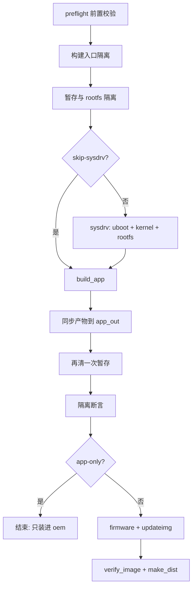

<div align="center">

</div>

<h1 align="center">QZdesk SDK</h1>

<p align="center">基于 Luckfox <b>RV1106</b> 的整机 SDK：交叉工具链、内核、rootfs、媒体库与 <code>oem</code> 树，一条命令产出 <b>QZdesk</b> 桌面端或 <b>QZcam</b> 摄像头端固件</p>

<p align="center">
🇨🇳 <a href="./README.md">简体中文</a> | 🇺🇸 <a href="./README.en.md">English</a>
</p>

---

> [!NOTE]
> 这是 **QZdesk SDK** —— [QZdesk](https://github.com/QZzwj/QZdesk)（桌面端 AI 终端）与 [QZcam](https://github.com/QZzwj/QZcam)（摄像头端）共用的底座。两个应用是各自独立的仓库，通过软链挂进本仓的 `project/app/`；SDK 负责板级配置、内核/rootfs、媒体库，以及它们装进去的 `oem` 树。

## 目录

- [项目简介](#项目简介)
- [板级与分区](#板级与分区)
- [仓库关系](#仓库关系)
- [快速开始](#快速开始)
- [一条命令出固件：tools/build](#一条命令出固件toolsbuild)
- [推送到板子上调试](#推送到板子上调试)
- [烧录](#烧录)
- [目录结构](#目录结构)
- [许可](#许可)

## 项目简介

QZdesk SDK 是 Luckfox Pico **RV1106** SDK 的整机化裁剪版：内核、u-boot、buildroot rootfs、Rockchip 媒体库都保留原样，只在 `project/app/` 与板级配置上做定制，好让同一个 SDK 同时托起两块屏幕形态完全不同的固件。

它对外只暴露「一条产线」的接口 —— [`tools/build/build_image.sh`](./tools/build/build_image.sh)：

| 你要的东西 | 一条命令 | 产物 |
| --- | --- | --- |
| 摄像头端（全屏取景，单个程序） | `tools/build/build_image.sh --cam` | `output/image/update-cam.img` |
| 桌面端（本地 AI 桌面终端） | `tools/build/build_image.sh --desk` | `output/image/update-desk.img` |

> [!IMPORTANT]
> 一个镜像里**只能有一套界面程序**。QZdesk 与 QZcam 同时存在会抢同一个 framebuffer，屏幕在两者之间来回跳。`build_image.sh` 用五层硬隔离保证这件事（见「硬隔离」一节），任何一层不过就停机、不产出镜像。

## 板级与分区

| 项 | 值 |
| --- | --- |
| 芯片 | RV1106（`RK_CHIP=rv1106`，ARMv7 Cortex-A7 + NPU），CMA 66 MB |
| 内核 | Linux **5.10.160**（`qzdesk_rv1106_linux_defconfig`） |
| u-boot | `qzdesk_rv1106_uboot_defconfig` |
| rootfs | Buildroot（`qzdesk_defconfig`，uclibc） |
| 存储介质 | SPI NAND（出厂），另有一份 SD 卡变体 |
| 内核 DTS | `rv1106g-qzdesk.dts` |
| WiFi | RTL8723BS（`RK_ENABLE_WIFI=y`） |
| 传感器 | SC4336 + SC3336，IQ 文件随固件打进 `oem` |
| 应用安装 | `RK_BUILD_APP_TO_OEM_PARTITION=y` —— app 装进 `oem` 分区 |

板级配置在 [`project/cfg/BoardConfig_IPC/`](./project/cfg/BoardConfig_IPC/)：

- `BoardConfig-SPI_NAND-Buildroot-RV1106_QZdesk-DeskMate.mk` —— 出厂 SPI NAND；
- `BoardConfig-SD_CARD-Buildroot-RV1106_QZdesk-DeskMate.mk` —— SD 卡变体（分区更大、`ext4`）。

SPI NAND 的分区表（`RK_PARTITION_CMD_IN_ENV`）与文件系统：

```text
env 256K | idblock 256K | uboot 512K | boot 4M | oem 45M | userdata 10M | rootfs 195M
rootfs@ubifs  oem@/oem@ubifs  userdata@/userdata@ubifs
```

## 仓库关系

三个仓库是一套：应用只管自己的代码，SDK 管底座，编译时靠软链把两者接起来。

| 仓库 | 角色 |
| --- | --- |
| **QZdesk-SDK**（本仓库） | 工具链、内核/rootfs/u-boot、媒体库、板级配置、`oem` 树、编译脚本 |
| [QZdesk](https://github.com/QZzwj/QZdesk) | 桌面端应用：LVGL 界面 + Rust 语音核心 |
| [QZcam](https://github.com/QZzwj/QZcam) | 摄像头端应用：全屏取景、拍照、录像、相册 |

SDK 侧的接线（都是软链，指向各自仓库的工作目录）：

```text
project/app/qzdesk/src  ->  <QZdesk>/           # 桌面端界面与核心源码
project/app/qzcam/src   ->  <QZcam>/            # 摄像头端源码
tools/                  ->  git 子模块（Luckfox 交叉工具链 + 烧录工具）
```

> [!NOTE]
> 只克隆 SDK 而不挂这两个仓库时，SDK 自带的 app（`rkipc`、`uvc_app_tiny`、`wifi_app`、`rk_smart_door` …）仍然能编；缺的只是 QZdesk / QZcam 这两套界面程序。

## 快速开始

```bash
git clone --recursive https://github.com/QZzwj/QZSDK.git
cd QZSDK
git submodule update --init          # 拉 tools/：交叉工具链 + 烧录工具
```

`.BoardConfig.mk` 不入库，克隆后先选一次板级（指向 SPI NAND 出厂配置）：

```bash
ln -s project/cfg/BoardConfig_IPC/BoardConfig-SPI_NAND-Buildroot-RV1106_QZdesk-DeskMate.mk .BoardConfig.mk
# 或交互式选板：./build.sh lunch
```

主机依赖（Ubuntu 22.04）：

```bash
sudo apt-get install -y git ssh make gcc gcc-multilib g++-multilib module-assistant \
  expect g++ gawk texinfo libssl-dev bison flex fakeroot cmake unzip gperf autoconf \
  device-tree-compiler libncurses5-dev pkg-config bc python-is-python3 passwd openssl \
  openssh-server openssh-client vim file cpio rsync
```

> [!WARNING]
> 打包镜像（`mkfs.ubifs` / `mkimage`）需要 **sudo**。`build_image.sh` 会提前检查，打包前先 `sudo -v` 或配置免密，否则会在最后一步才失败。

## 一条命令出固件：tools/build

[`tools/build/build_image.sh`](./tools/build/build_image.sh) 是**发布固件的唯一入口**：干净环境、板级检查、隔离、交叉编译、安装进 `oem`、打包、校验、出品带标签的发布副本，全在这一条命令里。

### 总览

| 能力 | 说明 |
| --- | --- |
| 一个入口、两条产线 | `--cam` 出摄像头端，`--desk` 出桌面端；两个目标各自决定编哪个 app、保留哪套自启脚本、装哪些依赖 |
| 干净构建环境 | 用 `env -i` 只带必要变量跑 `./build.sh`，一个 Windows / WSL 注入的变量都不引用 |
| 五层硬隔离 | 保证镜像里只有一套界面程序，任一层不过即停机 |
| 打包后断言 | 自启脚本计数、按名字扫残留、依赖裁剪确认、产物新鲜度、发布副本 md5 |
| 带标签的发布副本 | 除 `update.img` 外另出 `update-<target>.img` + `.txt`（编译时间、md5、板级、包含/剔除清单） |
| 安全预演 | `--dry-run` 只打印计划与校验，不动任何文件 |

### 用法

```bash
# 第一次用这个：完整重编（u-boot + kernel + rootfs + media + app）再打包
tools/build/build_image.sh --cam

# 日常最快：跳过 uboot/kernel/rootfs，只重编 app 再打包（1-2 分钟）
tools/build/build_image.sh --cam --skip-sysdrv

# 只编译 + 安装进 oem 树，不打包镜像
tools/build/build_image.sh --cam --app-only

# 桌面端固件（会先交叉编译 Rust 语音核心）
tools/build/build_image.sh --desk

# 只打印计划与校验，不动文件
tools/build/build_image.sh --cam --dry-run

# 指定并行度
tools/build/build_image.sh --cam -j 8
```

| 参数 | 作用 |
| --- | --- |
| `--cam` / `--desk` | 选目标产线（默认 `cam`）；别名 `--cameras` / `--desktop` |
| `--only <cam\|desk>` | 旧写法，等价于 `--cam` / `--desk` |
| `--skip-sysdrv` | 跳过 uboot/kernel/rootfs，沿用已有产物只重编 app |
| `--app-only` | 只编译 + 安装到 `oem` 树，不打包（隐含 `--skip-sysdrv`） |
| `--dry-run` | 预演：只打印计划与校验，不编译、不改文件 |
| `--keep-wifi` | 摄像头端保留 WiFi 依赖（默认剔除 `lib/wifi lib/firmware`） |
| `--keep-rkipc` | 摄像头端保留 `rkipc`（默认剔除，它会和 QZcam 抢 `/dev/video*`） |
| `--camera-demo` / `--demo` | 相机 demo 固件：额外编进 `rkipc`(RTSP) 与 UVC，临时给 `RK_APP_TYPE` 加 `UVC_TINY`（退出还原） |
| `--sdk-target <目标>` | 原样透传给 SDK 的 `./build.sh`（`lunch` / `kernel` / `rootfs` / `media` / `app` / `firmware` / `clean` …），跑完退出 |
| `--sdk <目录>` | 指定 SDK 根目录（默认按脚本位置回推上两级） |
| `-j` / `--jobs <N>` | 并行编译任务数（默认 `nproc`） |
| `--log <文件>` | 日志文件（默认 `/tmp/qzdesk-image.log`） |
| `-h` / `--help` | 打印脚本头部注释（用法即文档） |

| 环境变量 | 作用 |
| --- | --- |
| `QZCAM_SDK` | SDK 根目录（默认按脚本位置回推上两级） |
| `QZCAM_LOG` | 日志文件路径（默认 `/tmp/qzdesk-image.log`） |
| `QZCAM_REBUILD_CORE=1` | 桌面端强制重编 Rust 核心（平时产物在就不再编） |
| `QZCAM_ALLOW_STALE_CORE=1` | 核心交叉编译失败时沿用旧产物（默认直接报错退出） |

> [!NOTE]
> 构建日志写文件、随时可 `tail -f /tmp/qzdesk-image.log`。命令失败时脚本会自动回显日志里的 `error/fatal/failed` 关键行与日志尾部，不用自己去翻几百行输出。

### 目标档案：`--cam` 与 `--desk` 的差异

所有「选哪个」的差异都集中在脚本的 `setup_profile()` 里，一眼能看完两条产线的区别：

| 项目 | `--cam`（摄像头端） | `--desk`（桌面端） |
| --- | --- | --- |
| 界面程序 | `qzcam` | `qzdesk_screen` |
| 自启脚本 | `S30qzcam` | `S30qzdesk` |
| 额外编译 | — | 交叉编译 Rust 核心（`xiaozhi-linux-rs`，armv7-musl） |
| 剔除的程序 | `qzdesk_screen`、`xiaozhi_linux_rs`、MCP 脚本（`pomodoro.py`、`robot_move.sh`、`set_timer.py`、`system_status.sh`） | `qzcam`、`rkipc` |
| 剔除的自启脚本 | `S30qzdesk`、`S99qzdesk` | `S30qzcam`、`S99qzcam`、`S99qzdesk` |
| 剔除的依赖目录 | `lib/wifi`、`lib/firmware`（可用 `--keep-wifi` 保留）；`rkipc`、`rk_mpi_uvc`（可用 `--keep-rkipc` 保留） | `usr/share/qzcam`、`lib/camera` |
| 保留的关键依赖 | 相机驱动模块 6 个、`iqfiles`、`replace_desktop.sh`、`camera_doctor.sh`、`camera_paths_test.sh` | WiFi 模块与固件、中文字体、Rust 核心 |
| 产物 | `output/image/update-cam.img` | `output/image/update-desk.img` |

> [!CAUTION]
> 官方入口 `./build.sh app` 在 `LF_WIFI_PSK` / `LF_WIFI_SSID` 没配置时会**整段跳过**编译（日志里 `Skipping build_app`），编出来的就是空包。`build_image.sh` 因此绕开它，直接 `make -C project/app/<app>`，再把产物同步进打包目录。

### 硬隔离：五层，任何一层不过就停机

1. **构建入口** —— 把「不要的那套」的 `Makefile` 移出 `wildcard`（`qzdesk/Makefile` → `Makefile.qzdesk-off`），退出时自动还原；
2. **app 暂存** —— 删掉它的二进制 / 自启脚本（`project/app/out` 与 `output/out/app_out`）；
3. **rootfs 打包目录** —— 删掉上一版固件残留在 `output/out/rootfs_*` 里的自启脚本与二进制。打包只是 `cp -a` 追加/覆盖、从不删除，**这是最容易漏的一步**；
4. **依赖裁剪** —— 按目标剔除不属于它的依赖目录；
5. **打包后断言** —— 见下。

#### 打包后断言：最容易被忽略的一层

`verify_isolation()` 在打 `update.img` 前做一次全量体检，任一不满足就报错、**不产出镜像**：

- 本目标的界面程序在位，且 `file` 确认是 **ARM** 交叉编译产物（编成宿主版本推上去只会 `cannot execute`）；
- 自启脚本三处（app 暂存 ×2 + rootfs 打包目录）只能有本目标那一份，另一套 0 残留；
- 按名字扫另一套的残留文件（扫 `*qzdesk*` 或 `*qzcam*`）；
- 被裁剪的依赖目录**确实已消失**；
- 相机端特有：相机驱动模块 ≥ 5 个（`rk_dvbm/rkcif/rkisp/dphy/sc3336`），运维脚本齐全。

`verify_image()` 再补一刀：`update.img` 必须比 `qzcam` / `qzdesk_screen` 新，否则说明「烧了没变化」——打包没真正跑。

### 产物

| 文件 | 说明 |
| --- | --- |
| `output/image/update.img` | SDK 原始合并产物 |
| `output/image/update-cam.img` | 摄像头端发布副本（带类型标签） |
| `output/image/update-desk.img` | 桌面端发布副本（带类型标签） |
| `output/image/update-<target>.txt` | 标签文件：编译时间、大小、md5、板级/芯片/DTS、包含与剔除清单、烧录命令 |

标签文件长这样（真实产物示例）：

```text
# QZdesk（桌面端） 固件
target       : desk
编译时间     : 2026-10-14 17:32:18
镜像         : update-desk.img
大小         : 122731082 bytes
md5          : c05e73d530211aaac7392731402bc7c1
板级配置     : BoardConfig-SPI_NAND-Buildroot-RV1106_QZdesk-DeskMate.mk
芯片         : rv1106
DTS          : rv1106g-qzdesk.dts

界面程序     : qzdesk_screen
自启脚本     : S30qzdesk（oem + rootfs）
包含依赖     : WiFi 模块与固件、中文字体、Rust 核心（若已交叉编译）
隔离剔除     : QZcam 相机（qzcam / S30qzcam）；依赖目录 usr/share/qzcam lib/camera
```

### 内部流程

<!-- Experimental: if rendering fails, preview on GitHub -->


### 几个它替你处理的坑

<details>
<summary>展开：为什么这些步骤不是「多余」</summary>

| 坑 | 处理 |
| --- | --- |
| WSL 把 Windows 环境整套注进来，`PATH` 里的空格目录让 buildroot 的 `dependencies.mk` 直接报错 | `scrub_windows_env` + `sanitize_path` 清掉指向 Windows 的变量与 `PATH` 脏项；真正跑构建时再用 `env -i` 只带必要的几个变量 |
| `make -C project/app/<app>` 只装到 `project/app/out`，而打包读的是 `output/out/app_out`，不同步 = 空包 | `sync_app_out` 显式同步，并更新 `.image-manifest` 安装清单 |
| `oem` 树「只增不减」，上次装进去、这次不再产出的文件会永远留在镜像里 | 用 `.image-manifest` 比对，删掉对不上的旧文件，再写新清单 |
| rootfs 里 `/etc/iqfiles` 是指向 `../oem/usr/share/iqfiles` 的软链；app 若把 rootfs 侧 `iqfiles` 造成**目录**，`cp -rfa` 会失败 | 打包前清掉与软链冲突的目录，IQ 文件只保留在 `usr/share/iqfiles` |
| 中文字体源码侧是软链，指错要到 make 最后一步才炸、还淹没在几百行输出里 | `preflight` 提前判死并回显它指向哪；缺了界面中文会退回方框 |
| 有些环境装了「批量删除确认」保护，`rm -rf sysdrv/out/rootfs_*` 会让 make 报 `Error 1` | `preclean_rootfs` 提前把目录删掉，那次 `rm` 就成了空操作 |
| `--camera-demo` 要临时给板级加 `UVC_TINY` | `patch_board_for_uvc` 改的是软链指向的真实文件，`trap` 在退出时（含 Ctrl-C）还原 |

</details>

### 常用工作流

```bash
# 1) 首次/大改内核后：完整重编
tools/build/build_image.sh --cam

# 2) 只改了界面代码：跳过 sysdrv，最快
tools/build/build_image.sh --cam --skip-sysdrv

# 3) 只想验证能否编过，先看它准备干什么
tools/build/build_image.sh --desk --dry-run

# 4) 相机 demo：QZcam + RTSP(rkipc) + UVC 三条出图路径
tools/build/build_image.sh --camera-demo

# 5) 想直接用 SDK 原生目标
tools/build/build_image.sh --sdk-target media
tools/build/build_image.sh --sdk-target lunch
```

## 推送到板子上调试

改一次界面就重烧整包太慢，[`tools/build/deploy_qzcam.sh`](./tools/build/deploy_qzcam.sh) 用 adb 把交叉编译产物直接推到设备（落点与 `project/app/qzcam/Makefile` 的安装规则一一对应）：

```bash
tools/build/deploy_qzcam.sh              # 推程序 + 自启脚本 +（有的）相机模块，然后重启
tools/build/deploy_qzcam.sh --build      # 先跑一次 SDK 交叉编译再推
tools/build/deploy_qzcam.sh --modules    # 额外推相机驱动模块（第一次上机要）
tools/build/deploy_qzcam.sh --doctor     # 板上相机体检（节点/格式/占用，抓 1 帧验证）
tools/build/deploy_qzcam.sh --status     # 看设备状态（进程、日志、视频节点）
tools/build/deploy_qzcam.sh --log 20     # 部署后盯 20 秒日志
tools/build/deploy_qzcam.sh --paths uvc  # 切出图路径验证：lcd / v4l2 / rtsp / uvc
```

| 参数 | 作用 |
| --- | --- |
| `--build` | 先让 SDK 交叉编译，再部署 |
| `--modules` | 额外推相机驱动模块到 `/oem/usr/lib/camera/` |
| `--no-restart` | 只推，不重启 |
| `--no-replace` / `--replace-only` | 默认会做「接管桌面」（停用/替换 QZdesk）；这两个开关分别关掉 / 只做接管 |
| `--doctor` / `--status` / `--paths [all\|lcd\|v4l2\|rtsp\|uvc]` | 板上体检 / 状态 / 出图路径切换验证 |
| `--log <秒>` | 部署后盯一段日志 |

> [!NOTE]
> 脚本会拒绝把 x86 模拟器产物推上板（检测 `file` 输出里的 `x86-64`），避免推上去只会 `cannot execute`。多设备时用 `QZCAM_DEVICE=<adb 目标>` 指定。

QZdesk 桌面端的对应部署脚本在它的仓库里：`<QZdesk>/tools/deploy.sh`。

## 烧录

发布镜像归档在 [`IMAGE/`](./IMAGE/)；烧录用 SDK 自带工具：

| 主机 | 工具 |
| --- | --- |
| Linux | [`tools/linux/Linux_Upgrade_Tool`](./tools/linux/Linux_Upgrade_Tool) —— `sudo ./upgrade_tool uf update-cam.img` |
| Windows | [`tools/windows/`](./tools/windows) —— DriverAssitant（装驱动）+ SocToolKit / FactoryTool / RKDevTool |

```bash
# 全量升级：板子进 loader/maskrom，务必勾「擦除 Flash」，插着可引导 SD 卡请先拔掉
cd tools/linux/Linux_Upgrade_Tool
sudo ./upgrade_tool uf ../../output/image/update-cam.img

# 只改界面、设备已烧过同版本固件时，不必烧整包
tools/build/deploy_qzcam.sh --log 20

# 设备自查
adb shell "ls /oem/usr/etc/init.d/ /etc/init.d/ | grep -i qz"
adb shell "ps | grep -E 'qzcam|qzdesk'"
```

## 目录结构

```text
├── build.sh                 # -> project/build.sh（SDK 顶层构建入口）
├── rkflash.sh               # -> project/rkflash.sh
├── project/
│   ├── build.sh             # 真正的 SDK 构建驱动（lunch/kernel/rootfs/media/app/firmware…）
│   ├── app/                 # 应用：qzcam、qzdesk、rkipc、rk_smart_door、uvc_app_tiny、wifi_app
│   │   ├── Makefile         # wildcard ./*/Makefile —— 隔离就是靠这个
│   │   ├── qzdesk/          # src -> <QZdesk>，含 Rust 核心交叉编译与安装规则
│   │   └── qzcam/           # src -> <QZcam>，含 S30qzcam / replace_desktop.sh / 相机体检脚本
│   ├── cfg/                 # 板级配置（含 QZdesk-DeskMate 的 SPI NAND / SD 卡两份）
│   └── make_meta/           # 元数据与打包辅助
├── sysdrv/                  # u-boot、kernel 5.10.160、buildroot rootfs
├── media/                   # Rockchip 媒体库与样例（rockit / rkadk / mpp / isp / rga…）
├── tools/
│   ├── build/               # build_image.sh（出固件）+ deploy_qzcam.sh（推板子）
│   ├── linux/               # 交叉工具链、SocToolKit、打包/升级工具
│   └── windows/             # Windows 版烧录工具
├── output/
│   ├── out/                 # 编译中间产物：app_out、media_out、oem、rootfs_*、.image-manifest
│   └── image/               # update.img 与 update-{cam,desk}.img 发布副本
├── IMAGE/                   # 历史发布镜像归档
├── config/                  # dts / kernel / buildroot 快速配置
└── UPDATE_LOG.md            # 更新日志（含中文版）
```

## 与两个应用的对接

SDK 侧给应用提供的接口一共三样，应用的 README 也各自指向这里：

| 接口 | 位置 | 用途 |
| --- | --- | --- |
| 交叉工具链 | `tools/linux/toolchain/arm-rockchip830-linux-uclibcgnueabihf` | 编 ARM 产物（`source env_install_toolchain.sh` 进 `PATH`） |
| 媒体库 | `output/out/media_out` | 独立 CMake 编译 QZcam / QZdesk 时提供 `rockit`、`mpp`、`rga` 等 |
| `oem` 树 | `output/out/oem/usr` | 应用安装目标：`bin/` + `etc/init.d/` + `share/` + `lib/` |

```bash
# 独立 CMake 编译应用（真机）时，媒体库取自 SDK 的 media_out
cmake -S <QZcam> -B build -DQZCAM_MEDIA_DIR=<SDK>/output/out/media_out

# 或者干脆让 SDK 编它（推荐，走 build_image.sh）
tools/build/build_image.sh --cam --skip-sysdrv
```

## 文档

- 应用侧：[QZdesk](https://github.com/QZzwj/QZdesk) · [QZcam](https://github.com/QZzwj/QZcam)
- 上游 SDK：[LuckfoxTECH/luckfox-pico](https://github.com/LuckfoxTECH/luckfox-pico) —— 编译 / 烧录 / 调试的完整细节
- 更新日志：[UPDATE_LOG.md](./UPDATE_LOG.md) · [中文更新日志](./UPDATE_LOG_CN.md)
- 板级参数说明：`project/cfg-all-items-introduction.txt`

## 许可

本仓库**未附独立的 `LICENSE` 文件**；SDK 主体（u-boot、kernel、buildroot、媒体库、工具链）来自 Rockchip / Luckfox 上游，遵循其各自的开源许可与使用条款，商用前请以上游仓库说明为准。QZdesk / QZcam 应用仓库的许可各自在其仓库内声明。
